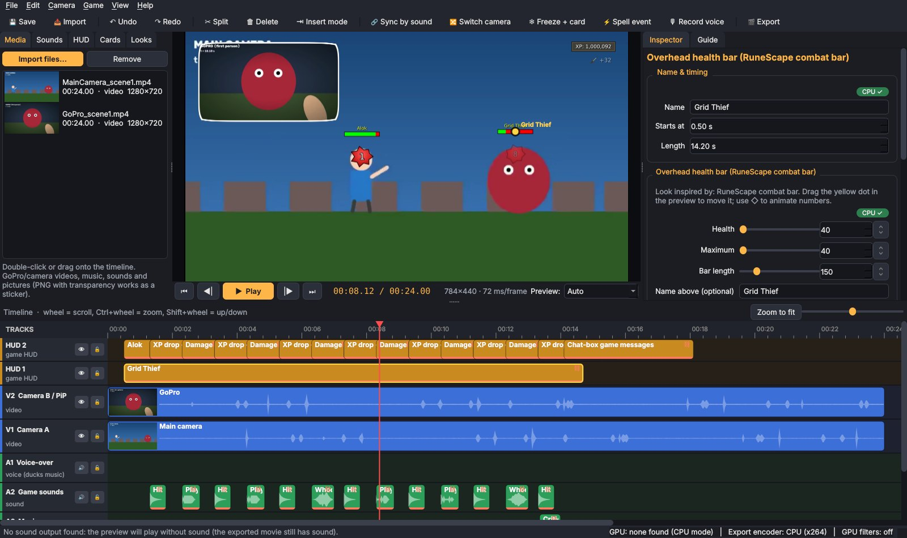
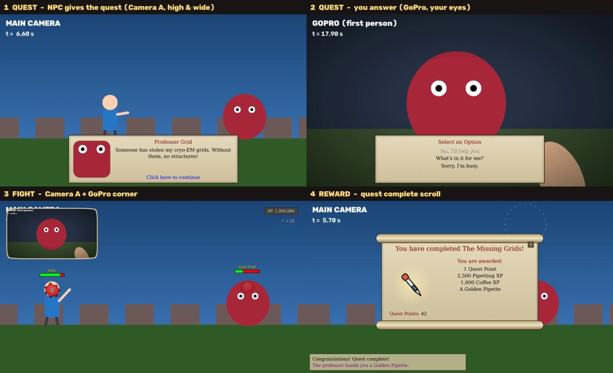
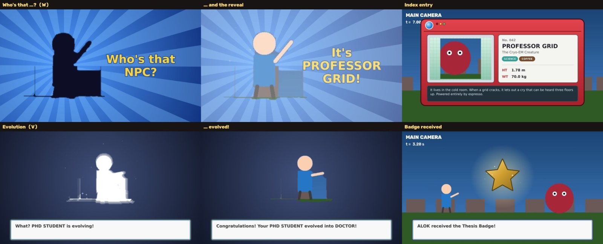
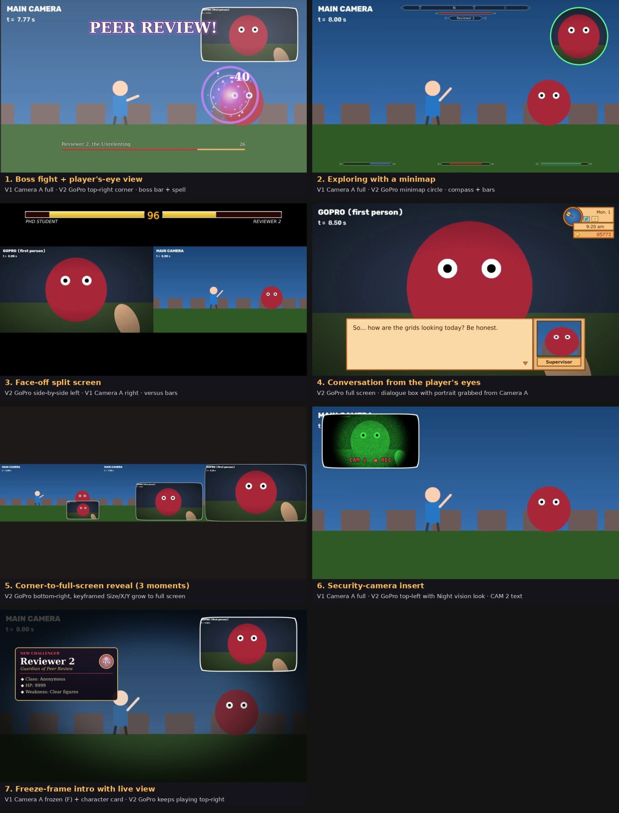
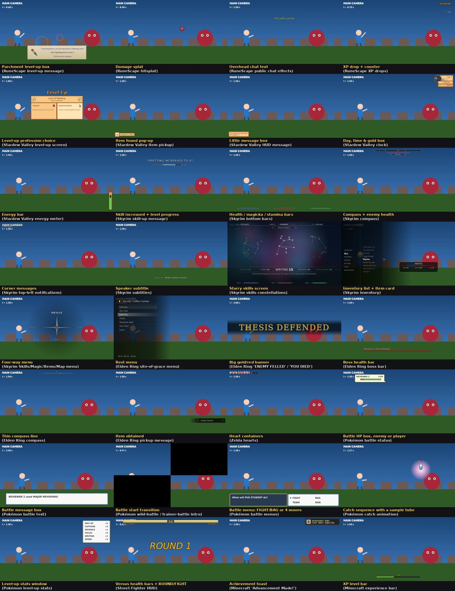
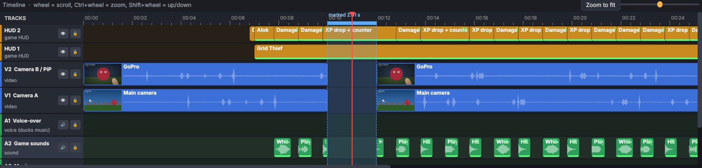

# QuestCut

**An easy desktop video editor for turning ordinary footage into a movie that looks like a video game.**
Made for a PhD movie filmed with a GoPro and a second camera, with colleagues playing the NPCs.
Runs on **Windows, macOS and Linux**; projects move freely between them, and the export is a normal MP4.

[](https://github.com/AlokBharadwaj94/questcut/actions/workflows/tests.yml)



## What it does

**Editing**
- Multi-track timeline: cut, trim, move, copy, paste, unlimited undo, keyframes on almost every number.
- **Two cameras**: sync by sound in one click (Y), switch camera with one key (A), picture-in-picture
  (corners, side by side, round "minimap").
- **Edits that move the whole movie**: *Insert mode* (a clip dropped in the middle pushes everything after it
  later, on every track), *insert empty time*, and *remove a marked stretch of time from every track* so nothing
  gets out of sync. Animations stay exact on both sides of a cut.
- **Select many** by dragging a box, move or delete them together, and **group** pieces (G) so they always move as one.
  Every one-click sequence comes out as a group.

**Looking like a game**
- **Game HUD** in three looks (retro pixel, fantasy RPG, sci-fi shooter): health/mana/XP/boss bars, name tags,
  dialogue, quests, character cards, score, timer, ammo, minimap, kill feed, prompts, menus, level-up, damage
  numbers and screen frames.
- **Spell / attack event** (E): spell name, flying orb, cast and hit sounds, flash, shake, and the target's health
  bar dropping at exactly the hit.
- **42 game-inspired elements**, each named after the screen it imitates. Only the idea is borrowed; every graphic
  is drawn by QuestCut:
  - **RuneScape**: NPC chat box with talking head, *Select an Option*, overhead health bars with damage splats,
    *Quest complete* scroll, chat-box messages, level-up box, XP drops. One-click **quest conversation (Q)** and
    **fight (K)**.
  - **Pokémon-style**: battle-start transition (B), HP boxes, battle text and menus, catch sequence (C),
    **Who's that …? (W)**, **evolution (V)**, index entry, badge received, level-up stats.
  - **Stardew Valley**: dialogue with a face grabbed from your video, item pop-up, clock, energy bar, level-up choice.
  - **Skyrim**, **Elden Ring**, **Zelda**, **Street Fighter**, **Minecraft**: skill-ups, compass, boss bar,
    "item obtained", hearts, versus bars, achievement toast and more.
- Any photo or video frame can be used as a picture; for silhouettes, the person is cut out of the background
  automatically.
- **Looks** (retro pixel, sepia, night vision, glitch, CRT, VHS, comic, thermal, dream), **vignettes**,
  **touch-ups** (blur, pixelate, highlight one area), freeze-frame character intros, title / Game Over / Level
  Complete / credits cards, game-style transitions.

**Sound**
- Camera sound, **33 built-in game sounds** and **18 pieces of music**, all generated by QuestCut, so there are no
  copyright problems: a stereo orchestral set in a *medieval quest* mood (quest giver, quest accepted, setting off,
  tavern, sneaking, battle, quest-complete fanfare) and a *dark fantasy* mood (monster steals the treasure, dread,
  dark boss with choir, enemy felled, resting place, lament), plus 5 retro 8-bit loops. Voice-over recording,
  fades, automatic music ducking under voices.

**Practical**
- GPU support where it helps (NVIDIA NVENC / CuPy, Apple VideoToolbox, Intel QuickSync), with a panel that shows
  which steps use it.
- Pack a project for another computer; combine scene projects into one movie; autosave.
- A **Guide** tab with 14 hands-on lessons and a practice project.

| A RuneScape quest: talk, answer, fight, reward | More creature-collecting moments |
|---|---|
|  |  |

| Two cameras: ways to combine them | Game-inspired elements |
|---|---|
|  |  |



---

## 1 · Install and start

You need **Python 3.9 or newer** (3.11 or 3.12 recommended). The first start installs everything else into a
private folder (`.venv`) next to QuestCut. This takes a few minutes, once.

**Get QuestCut:** on this GitHub page click **Code → Download ZIP** and unzip it, or with git:
```bash
git clone https://github.com/AlokBharadwaj94/questcut.git
```

**Update later:** `git pull` inside the folder (or download the ZIP again and replace the folder). Your projects
and footage live elsewhere and are not touched. The `.venv` folder can stay; new requirements are installed on the
next start.

### Windows
1. Install Python from <https://www.python.org/downloads/>. During installation, **tick "Add python.exe to PATH"**.
2. Unzip QuestCut somewhere (e.g. `Documents\QuestCut`).
3. Double-click **`Start QuestCut (Windows).bat`**.

### Mac
1. Install Python from <https://www.python.org/downloads/>.
2. Unzip QuestCut (e.g. into `Documents`).
3. Double-click **`Start QuestCut (Mac).command`**.
   If macOS says it is from an unidentified developer: **right-click → Open → Open**.
   Or open Terminal, `cd` into the folder and run `python3 run_questcut.py`.
4. The first time you record a voice-over, macOS asks for microphone permission. Click Allow.

### Linux (the lab PC with the NVIDIA GPU)
```bash
sudo apt install python3-venv ffmpeg     # system ffmpeg usually includes the NVIDIA encoder (NVENC)
cd QuestCut
./start_questcut_linux.sh --gpu          # first time: also installs CuPy for GPU filters
./start_questcut_linux.sh                # every time after that
```
`--gpu` installs `cupy-cuda12x`. If the lab driver is CUDA 11, run
`.venv/bin/pip install cupy-cuda11x` instead. The bottom bar of QuestCut tells you what it found, for example
`GPU: NVIDIA RTX … | Export encoder: NVIDIA GPU (NVENC) | GPU filters: on (CuPy)`.

---

## 2 · First 10 minutes

1. Start QuestCut. The **Guide** tab opens on the right.
2. Click **Create practice project**. It makes two short fake "camera" videos (a main camera and a first-person
   GoPro) whose sound starts 1.7 s apart.
3. Follow lessons 1 to 5 in the Guide: cut, sync, switch camera, add a HUD, make a health bar drain, cast a spell.
   Then use the same steps on your real footage.

The most useful keys: **Space** play/pause · **S** cut · **Delete** · **A** switch camera · **Y** sync ·
**F** freeze + character card · **E** spell event · **R** record voice · **Ins** insert mode ·
**I / O** mark time · **Ctrl+Shift+Delete** remove marked time · **G** group · **Ctrl+Z** undo (⌘ on Mac).

---

## 3 · What the GPU speeds up

| Task | Normal laptop CPU | Note |
|---|---|---|
| Cutting, moving, trimming | ✓ instant | |
| Live preview | ✓ smooth | uses small 540p "proxy" copies made in the background |
| Sound, game sounds, ducking, sync | ✓ | |
| Transitions, HUD, cards, spells | ✓ | |
| Filters, looks, vignettes, touch-ups | ✓ preview | **export faster** with NVIDIA GPU + CuPy |
| Final export (encoding) | ✓ about real-time or slower | **several times faster** with NVIDIA (NVENC), Apple (VideoToolbox) or Intel (QuickSync) |
| Steadying shaky GoPro footage | slow, background | CPU only (the GPU does not help this step); a PC with more cores is faster |

Help → *What does the GPU speed up?* shows the same table plus what your computer has.

Measured on a small 2-core test machine (no GPU): a 1080p frame with picture-in-picture, a vignette and 11 HUD
elements takes about 60 ms, so exporting 10 minutes takes roughly 20–30 min. A modern laptop is about 2–3×
faster, and the lab PC with NVENC is faster again. Use **Export → Quick test (10 s)** to check a scene first.

---

## 4 · Working on several computers (office ↔ home Mac ↔ lab GPU)

- **File → Pack project for another computer…** copies the project file and every video, sound and recording
  into one folder. Copy that folder (USB drive, SURFdrive, OneDrive…) and open the `.questcut` file inside it on
  the other computer.
- Paths inside a packed folder are stored relative to the project, so Windows, Mac and Linux all find the files.
- If files have moved, QuestCut asks for a folder and searches it (including subfolders) by file name.
- The `QuestCut_cache` folder (preview copies, sound caches) is rebuilt automatically, so you don't need to copy it.
- **File → Combine projects…** joins several scene projects one after another (with an optional gap), e.g.
  one project per scene, combined into the full movie at the end. The original projects are not changed.
- QuestCut autosaves every 2 minutes to `<name>.autosave.questcut` next to your project.

---

## 5 · Tips for filming the rest of the movie

- **Clap once** at the start of every take that both cameras film. Sync is then nearly perfect.
- Film the GoPro at the same frame rate as the camera if possible (e.g. both 30 or both 25 fps). Different
  rates still work.
- Leave a second or two before and after each action. It gives room for transitions and spell timing.

---

## 6 · Troubleshooting

| Problem | Fix |
|---|---|
| "No sound output found" | The computer has no working sound device; the export still has sound. |
| No microphone | Record the voice-over on a phone and **Import** it, then drag it onto the voice-over track. |
| Preview is slow | Set *Preview* (under the picture) to *Half* or *Quarter*. Wait until "preparing preview…" has gone from the Media list. |
| Export fails with the GPU encoder | QuestCut retries automatically on the CPU. You can also pick *CPU (x264)* in the export window. |
| Sync says "weak" | The two sounds didn't match clearly. Drag the clip by hand while watching the waveforms, or film a clap next time. |

---

## 7 · Good to know (current limits)

- Changing a clip's **speed** also changes its sound pitch (fun for chipmunk or slow-motion voices; mute it if not wanted).
- HUD elements that overlap in time each get their own HUD track, so busy scenes create extra HUD rows.
  Scroll the timeline with Shift + mouse wheel or the scrollbar on the right.
- Exports are H.264 MP4 with AAC sound, the most compatible format (QuickTime, Keynote, PowerPoint, phones,
  projectors).

---

## 8 · For developers

```
questcut/
  model.py        project, tracks, clips, keyframes; saving; combining projects
  edit_ops.py     whole-movie edits: split, insert time, remove time, groups
  renderer.py     draws one frame (video layers, effects, HUD)
  hud.py          base HUD elements, spell links between spells/splats and health bars
  game_skins.py   game-inspired elements (RuneScape, Stardew, Skyrim, Elden Ring, Pokémon-style, …)
  creature.py     Who's that …?, index entry, evolution, badge, automatic cut-out
  rs_combos.py    plans for the one-click quest conversation and fight
  audio.py        mixing, ducking, sync by sound, built-in sounds
  orchestra.py    virtual instruments (harp, lute, flute, strings, brass, choir, drums) and hall echo
  music_themes.py the orchestral music pieces
  export.py       parallel export with GPU encoders when available
  ui/             the Qt windows: timeline, viewer, inspector, dialogs, guide
tests/            pytest suite (runs without a screen)
```

Run the tests with:
```bash
pip install pytest
QT_QPA_PLATFORM=offscreen python -m pytest -q tests
```
On GitHub they run on Linux, Windows and macOS when started by hand: **Actions → tests → Run workflow**.

Built with Python, Qt for Python (PySide6), PyAV/FFmpeg, NumPy and OpenCV. The pixel font, HUD graphics,
sounds and music are all original and generated by the program. Game names are used only to describe which
screen an element is inspired by; QuestCut is not affiliated with any of those games or companies.

Licensed under the MIT licence (see `LICENSE`).
